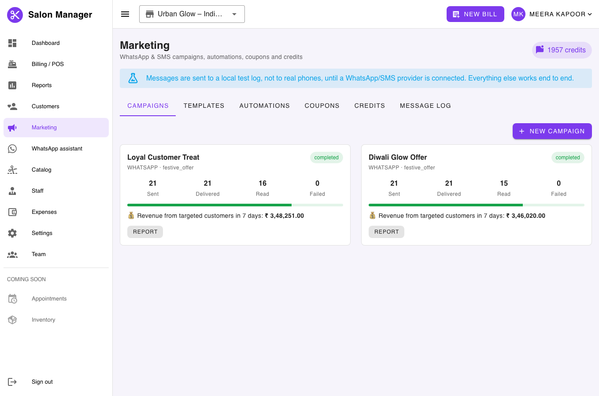
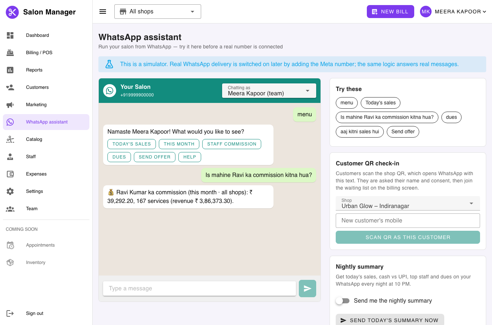
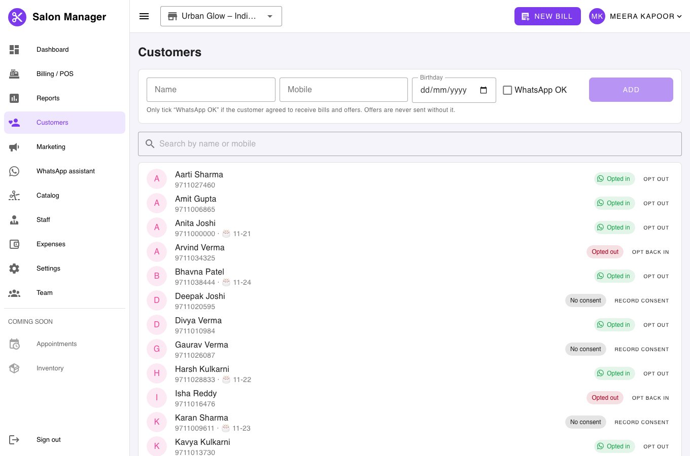
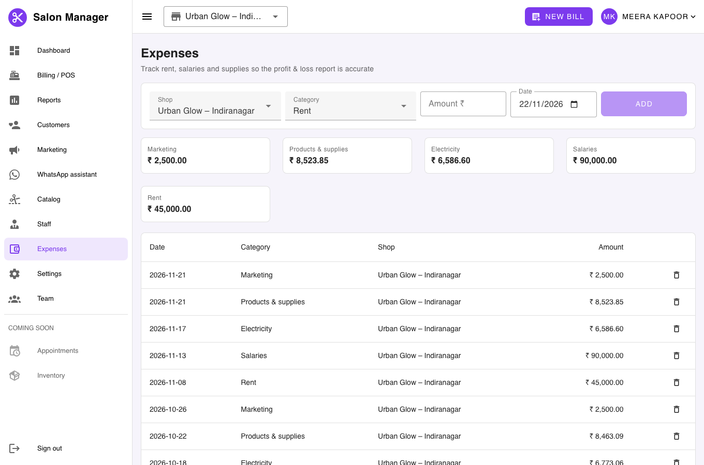
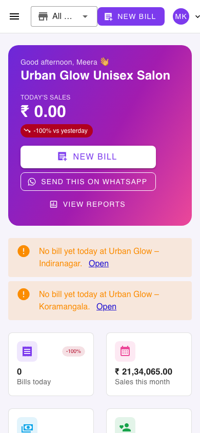

# Salon Manager SaaS

A complete software platform for running a salon (or a chain of salons). Owners see sales, staff and customers at a glance; the front desk bills customers in seconds, even without internet; and marketing, reports and a WhatsApp assistant are built in. Many salons can use the same system, and each salon only ever sees its own data.

**Stack:** Laravel 13 (PHP 8.3) · Vue 3 + Vuetify + Pinia · MySQL · Sanctum login · Spatie roles/permissions · PWA + Capacitor (Android).

> **Important:** WhatsApp, SMS, online payments, the AI model, speech-to-text and push notifications are **local fakes** for now. Messages are written to a log table instead of reaching real phones, payments settle instantly, and the "AI" is keyword rules. Real providers plug in later behind the same interfaces. See [docs/INTEGRATIONS.md](docs/INTEGRATIONS.md).

## Screenshots

**Owner dashboard:** today's sales, 30-day trend, staff leaderboard, shop comparison, and "Ask your salon".


| Billing counter | Reports |
|---|---|
|  |  |

| Marketing campaigns | WhatsApp assistant (simulator) |
|---|---|
|  |  |

| Customers | Expenses |
|---|---|
|  |  |

| Super admin | Role permissions | Mobile |
|---|---|---|
|  |  |  |

---

## Who can do what

There are five kinds of people. Each one sees a different menu after login.

### 1. Platform super admin (the company that sells the software)
Logs in and sees only **Salons** and **Roles & permissions**.
- See every salon that uses the platform, its plan and its status.
- **Change a salon's plan** (Free / Basic / Pro) or **suspend** a salon (its users are blocked until reactivated).
- **Edit what each role may do** (for example, allow managers to give refunds), with changes enforced on the server.
- Cannot see salons' private business screens; this account is for managing the platform.

### 2. Salon owner
Sees the full menu: Dashboard, Billing / POS, Reports, Customers, Marketing, WhatsApp assistant, Catalog, Staff, Expenses, Settings, Team. Can switch between **All shops** and a single shop.
- **Dashboard:** today's sales and how it compares with yesterday, bills today, sales this month, average bill, unique customers; a 30-day revenue chart; how customers pay (cash / card / UPI); pending dues; top services; staff leaderboard with commission earned; shop-vs-shop comparison; alerts such as "no bill yet today at this shop".
- **Ask your salon:** type or speak a question in English, Hinglish or Hindi, e.g. *"Is mahine Ravi ka commission kitna hua?"*, *"Baki kitna hai?"*, *"Top services this month"*. It answers from real data. It can also draft a win-back offer, but nothing is sent until the owner confirms.
- **Reports:** sales, services and products, staff and commission, payments, dues, profit and loss, GST, campaign ROI and more (11 types). Pick Today / 7 days / 30 days / This month / custom dates, then **export to CSV, Excel or PDF**, or print.
- **Customers:** customer list with visit history, dues, birthday/anniversary and message-consent settings.
- **Marketing:** send WhatsApp/SMS campaigns (pick audience, template, schedule; see the cost before confirming), manage message templates, set up automations (birthday wishes, win-back, post-visit thank-you), create coupons, view the message log, and watch a **credits balance** (buy credit packs; every message uses credits).
- **WhatsApp assistant:** run the salon from WhatsApp: ask for today's sales, month sales, staff commission or dues; approve or skip a suggested offer with one tap; receive a **nightly summary**; get a **QR check-in** for the shop so new customers can join the waiting list.
- **Catalog:** services and products with prices, GST and stock.
- **Staff:** staff profiles and commission rules.
- **Expenses:** record rent, salaries, supplies etc. so the profit-and-loss report is correct.
- **Settings and Team:** shop details, invoice settings, add shops, invite managers and cashiers and assign them to shops.
- Bills at the counter like everyone else (see Cashier).

### 3. Manager
Sees Dashboard, Billing / POS and Customers. By default a manager can: create and edit bills, give refunds, override discounts, manage customers, manage attendance and view daily reports. The super admin can change these permissions.

### 4. Cashier / front desk
Sees Dashboard, Billing / POS and Customers. By default a cashier can create bills, manage customers and see today's numbers.
- **Billing counter:** tap services and products to build a bill, search or add the customer by mobile number, apply a discount, tip or **coupon code**, see GST and the total, take **cash / UPI / card**, allow part payment (the rest becomes a due), then save. Each bill is numbered per financial year (e.g. `UGI/2026-27/00617`).
- **Waiting list:** customers who scanned the QR check-in appear here, ready to be billed.
- **Works offline:** if the internet drops, bills are saved on the device and sent automatically when it is back, with no duplicates.
- Bills trigger the customer's invoice message and commission for the staff who served them.

### 5. Staff (stylist)
Has a role with "view own earnings" permission. The screen for this is not built yet; staff members currently have no day-to-day screen of their own.

### 6. Customer (no login)
Customers never log in to the app. They:
- **Scan the shop's QR code**, which opens WhatsApp, and give their name and consent to be messaged. They then appear on the waiting list at the counter.
- **Receive messages** (invoice, offers, birthday wishes, reminders) only if they gave consent; anyone who opted out is never messaged.

---

## Feature checklist

| Area | What is included |
|---|---|
| **Multi-salon (multi-tenant)** | Each salon's data is isolated; owners can run several shops; suspended salons are blocked. |
| **Login and roles** | Email/password and mobile OTP (OTP is faked locally); roles per shop; permissions checked on the server every time. |
| **Billing** | GST, discounts, tips, coupons, split payments, dues, per-year bill numbers, safe against double-saves, staff commission snapshot. |
| **Offline** | Installable as an app (PWA), offline bill queue with automatic sync. |
| **Reports** | 11 reports, CSV / Excel / PDF export, fast dashboard (median 0.72 s with 100,000 bills). |
| **Marketing** | Campaigns, templates, automations, coupons, credits ledger, delivery status, consent rules, signed webhooks. |
| **WhatsApp assistant** | Owner menu, approvals, nightly summary, staff alerts, QR check-in (simulated in the app). |
| **AI assistant** | English / Hinglish / Hindi questions, whitelisted data tools, monthly quota by plan. |
| **Mobile** | Responsive UI, installable PWA, Android project scaffold, receipt-printing helper (stub). |
| **Platform admin** | Plans, suspend/reactivate salons, editable role permissions. |

## What is simulated or not done yet

- **Simulated:** WhatsApp and SMS delivery, payments, the AI model, server-side speech recognition (voice input uses Chrome's built-in recognition), push notifications.
- **Android:** only a scaffold; no APK has been built or tested on a device. Bluetooth receipt printing is a stub.
- **Not built:** appointments and inventory (shown as "Coming soon"), a staff self-service screen, WhatsApp template sync with Meta, per-salon WhatsApp numbers, Razorpay subscriptions, per-salon permission overrides.
- **Known UI gap:** on a phone, the billing cart appears below the item grid, so you scroll to reach it.

## Run locally

```bash
# Backend (MySQL on 127.0.0.1:8889, database salon_saas; copy backend/.env.example to .env)
cd backend
composer install
php artisan migrate
php artisan demo:seed        # three demo salons, staff, ~60 days of bills
php artisan serve            # http://localhost:8000

# Frontend
cd frontend
npm install
npm run dev                  # http://localhost:5173
```

Sign in with the **Email / password** tab using the demo accounts in [docs/CREDENTIALS.md](docs/CREDENTIALS.md). Run `php artisan demo:seed --topup` before a demo so "Today" is not empty.

Tests: `cd backend && php artisan test` (54 tests) · `cd frontend && npm test` (8 tests).

## Before using this for real

- Change the dev-only secrets (webhook secret, verify token) and the seeded super-admin password.
- Never run `demo:seed` on a real server.
- Run a queue worker and set `MESSAGING_SYNC=false` when connecting real WhatsApp/SMS providers.

## More docs

[CREDENTIALS](docs/CREDENTIALS.md) · [DEMO script](docs/DEMO.md) · [INTEGRATIONS](docs/INTEGRATIONS.md) · [MOBILE](docs/MOBILE.md) · [Roadmap and build status](docs/NEW-EXPECTATIONS-PLAN.md) · [MVP plan](docs/MVP-BUILD-PLAN.md) · [Feature specification](docs/FEATURE-SPECIFICATION.md)
