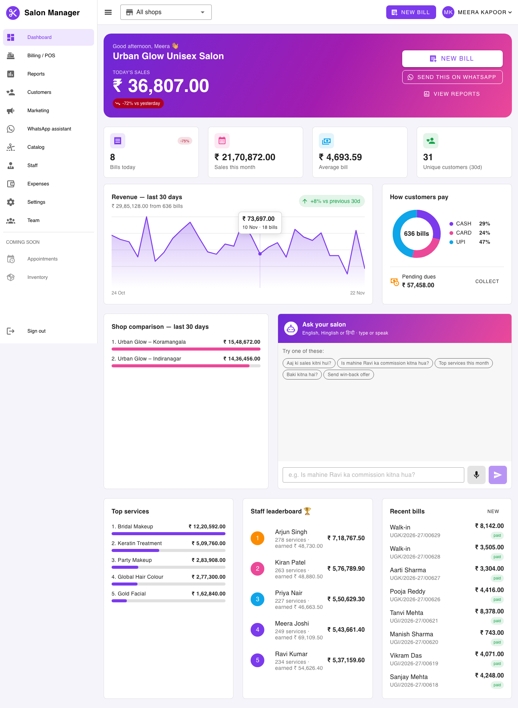
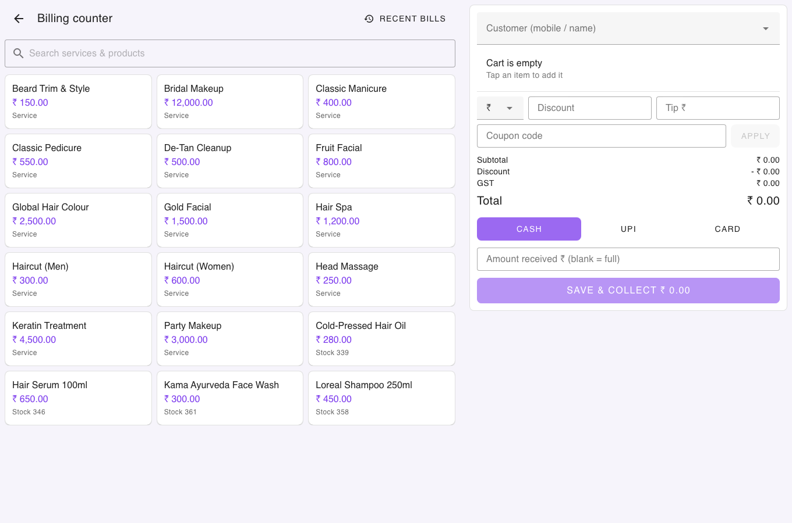
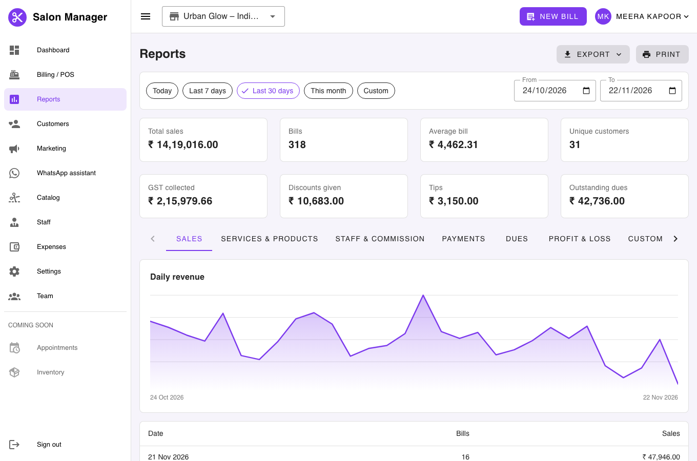
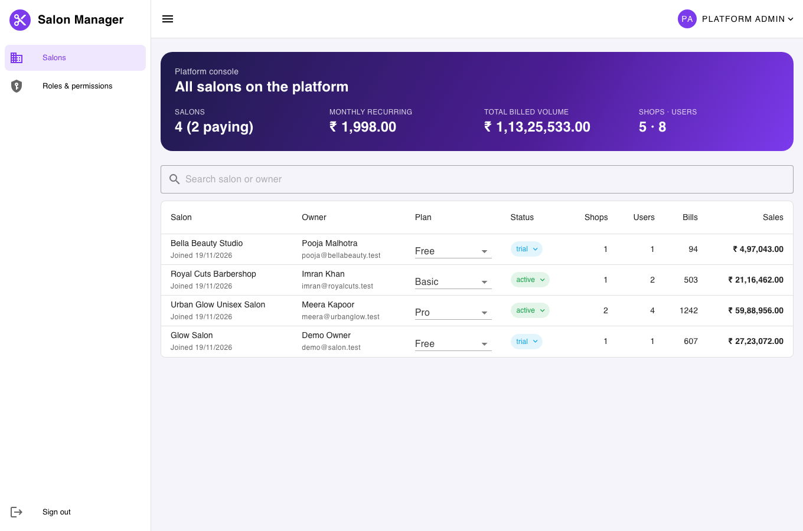
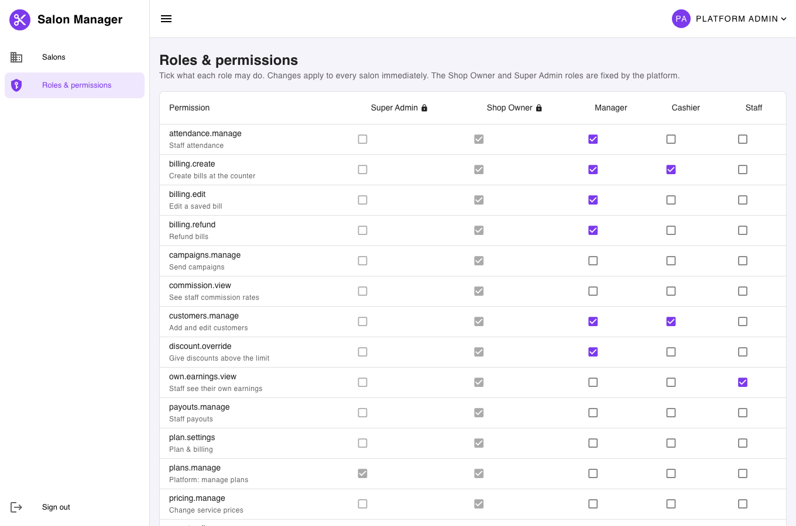

# Salon Manager SaaS

Multi-tenant salon management platform: GST billing/POS with staff commissions, sales and P&L reports (CSV/Excel/PDF), WhatsApp campaigns and automations with a credits ledger, a WhatsApp assistant with QR check-in, an "ask your salon" chat, and an offline-capable PWA with a Capacitor Android scaffold.

**Stack:** Laravel 13 (PHP 8.3) · Vue 3 + Vuetify + Pinia · MySQL · Sanctum · Spatie permissions.

> WhatsApp, SMS, payments, LLM, speech-to-text and push are **local fakes** behind interfaces (see [docs/INTEGRATIONS.md](docs/INTEGRATIONS.md)). Messages go to a `message_log` table, not to real phones.

## Screenshots

| | |
|---|---|
| **Owner dashboard**: KPIs, 30-day trend, staff leaderboard, shop comparison, "Ask your salon" |  |

| Billing counter | Reports |
|---|---|
|  |  |

| Marketing campaigns | WhatsApp assistant (simulator) |
|---|---|
|  |  |

| Customers | Expenses |
|---|---|
|  |  |

| Super admin | Role permissions | Mobile |
|---|---|---|
|  |  |  |

## Run locally

```bash
# backend (MySQL on 127.0.0.1:8889, db salon_saas; see backend/.env.example)
cd backend && composer install && php artisan migrate && php artisan demo:seed && php artisan serve

# frontend
cd frontend && npm install && npm run dev      # http://localhost:5173
```

Demo logins: [docs/CREDENTIALS.md](docs/CREDENTIALS.md) · demo script: [docs/DEMO.md](docs/DEMO.md) · mobile: [docs/MOBILE.md](docs/MOBILE.md) · roadmap: [docs/NEW-EXPECTATIONS-PLAN.md](docs/NEW-EXPECTATIONS-PLAN.md).
